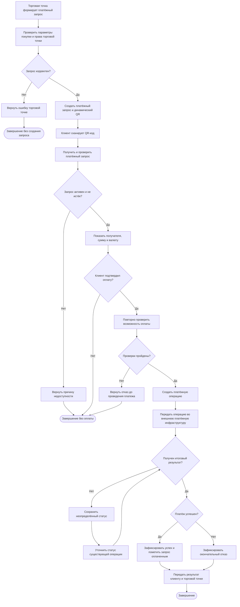

# Бизнес-процесс: оплата покупки по динамическому QR-коду

## 1. Общая информация

| Параметр | Значение |
|---|---|
| Идентификатор | BP-01 |
| Наименование | Оплата покупки по динамическому QR-коду |
| Цель | Обеспечить оплату покупки клиентом с использованием QR-кода |
| Инициатор | Клиент или торговая точка в зависимости от этапа процесса |
| Основной участник | Клиент банка |
| Результат | Платёж выполнен, отклонён либо остаётся в обработке до определения итогового статуса |
| Приоритет | Высокий |
| Статус документа | Черновик проектного решения |

## 2. Цель и границы процесса

Процесс охватывает формирование платёжного запроса для покупки, создание динамического QR-кода, получение клиентом информации о платеже, подтверждение операции, передачу платежа во внешнюю платёжную инфраструктуру и обработку результата.

В рамках текущей версии рассматривается оплата покупки в офлайн-точке продаж. Торговая точка использует интегрированную с сервисом систему для формирования платёжного запроса.

### Входит в процесс

- Формирование платёжного запроса торговой точкой.
- Создание динамического QR-кода.
- Сканирование QR-кода клиентом.
- Проверка актуальности платёжного запроса.
- Отображение информации о получателе и сумме.
- Подтверждение платежа клиентом.
- Передача операции во внешнюю платёжную инфраструктуру.
- Получение и сохранение результата платежа.
- Информирование клиента и торговой точки о результате.

### Не входит в процесс

- Оформление заказа и расчёт стоимости покупки на стороне торговой точки.
- Регистрация и подключение торговой точки к банковскому обслуживанию.
- Возврат денежных средств.
- Формирование фискального чека.
- Урегулирование спорных операций.

## 3. Участники процесса

| Участник | Ответственность |
|---|---|
| Клиент | Сканирует QR-код, проверяет параметры покупки и подтверждает оплату |
| Система торговой точки | Передаёт параметры покупки и получает результат платежа |
| Мобильное приложение банка | Предоставляет интерфейс сканирования QR и подтверждения операции |
| Сервис оплаты по QR-коду | Создаёт платёжный запрос, проверяет его актуальность и организует проведение платежа |
| Внешняя платёжная инфраструктура | Обрабатывает платёж и передаёт результат |
| Сервис уведомлений или механизм доставки событий | Обеспечивает передачу результата торговой точке, если используется отдельный компонент |

## 4. Предусловия

1. Торговая точка зарегистрирована в системе и имеет право принимать платежи.
2. Система торговой точки располагает данными о покупке.
3. Клиент авторизован в мобильном приложении банка.
4. У клиента и платёжного сервиса есть доступ к интернету.
5. Для проведения платежа доступна необходимая платёжная инфраструктура.

Предусловия не гарантируют успешную оплату: окончательные проверки выполняются во время обработки запроса.

## 5. Основной сценарий

### Этап 1. Формирование QR-кода

1. Торговая точка инициирует создание платёжного запроса и передаёт идентификатор заказа, сумму, валюту и необходимые сведения о покупке.
2. Сервис проверяет корректность входных данных, доступность торговой точки и допустимость суммы.
3. Сервис создаёт платёжный запрос и присваивает ему уникальный идентификатор.
4. Для запроса формируется динамический QR-код, связанный с конкретной покупкой.
5. Сервис передаёт QR-код торговой точке для отображения покупателю.

### Этап 2. Получение информации о платеже

6. Клиент сканирует QR-код через мобильное приложение банка.
7. Приложение извлекает идентификатор платёжного запроса и передаёт его сервису.
8. Сервис проверяет существование запроса, срок действия и возможность оплаты.
9. При успешной проверке сервис возвращает сведения о получателе, сумме, валюте и назначении платежа.
10. Приложение отображает полученные сведения клиенту.

### Этап 3. Подтверждение и проведение платежа

11. Клиент проверяет сведения и подтверждает оплату.
12. Сервис повторно проверяет допустимость операции, включая доступность платёжного запроса и применимые ограничения.
13. Сервис создаёт платёжную операцию с уникальным идентификатором и передаёт запрос во внешнюю платёжную инфраструктуру.
14. Внешняя система обрабатывает запрос и возвращает окончательный результат либо сообщает, что обработка ещё продолжается.
15. Сервис сохраняет полученный статус.

### Этап 4. Завершение процесса

16. При получении окончательного результата сервис передаёт его мобильному приложению и торговой точке.
17. Приложение показывает клиенту результат операции.
18. Информация о платеже сохраняется для просмотра в истории операций.
19. Если результат пока не определён, клиенту отображается статус обработки. Сервис продолжает выяснение результата без создания дублирующей платёжной операции.

## 6. Альтернативные сценарии и исключения

| ID | Ситуация | Поведение системы | Результат |
|---|---|---|---|
| ALT-01 | QR-код не распознан или имеет некорректный формат | Сервис не создаёт платёжную операцию и возвращает ошибку | Оплата не инициирована |
| ALT-02 | Платёжный запрос не найден | Сервис возвращает сообщение о невозможности оплаты | Оплата не инициирована |
| ALT-03 | Срок действия запроса истёк | Сервис запрещает проведение платежа | Оплата не инициирована |
| ALT-04 | Запрос уже оплачен или деактивирован | Сервис не допускает повторную оплату | Новая операция не создаётся |
| ALT-05 | Клиент отменил действие до подтверждения | Приложение закрывает сценарий оплаты | Платёжная операция не создаётся |
| ALT-06 | Проверка ограничений не пройдена | Сервис не передаёт платёж на проведение и возвращает соответствующий результат | Оплата не выполнена |
| ALT-07 | Внешняя система отклонила платёж | Сервис сохраняет результат отказа и информирует участников | Оплата не выполнена |
| ALT-08 | При обработке возник тайм-аут | Сервис уточняет результат ранее отправленной операции | Статус может оставаться неопределённым |
| ALT-09 | Клиент повторно отправил запрос подтверждения | Сервис обрабатывает повторный запрос с учётом механизма идемпотентности | Дублирование платежа предотвращается |
| ALT-10 | Не удалось уведомить торговую точку | Сервис фиксирует неуспешную доставку и инициирует повторную отправку по установленным правилам | Статус самого платежа не изменяется из-за ошибки уведомления |

## 7. Бизнес-правила

| ID | Правило |
|---|---|
| BR-01 | Динамический QR-код предназначен для оплаты конкретной покупки |
| BR-02 | Сумма покупки определяется торговой точкой и не редактируется клиентом в рамках основного сценария |
| BR-03 | До подтверждения клиенту должны быть доступны сведения о получателе и сумме платежа |
| BR-04 | Платёжный запрос с истёкшим сроком действия не может быть использован для новой оплаты |
| BR-05 | Один платёжный запрос не должен приводить к двум успешным оплатам одной покупки |
| BR-06 | Тайм-аут при ожидании ответа не является доказательством отказа в проведении платежа |
| BR-07 | Ошибка доставки уведомления не должна автоматически менять итоговый статус платежа |
| BR-08 | Фактический результат операции определяется платёжной инфраструктурой и подтверждёнными данными о состоянии платежа |

## Схема процесса

## 8. Постусловия

### При успешной оплате

- Платёжная операция имеет успешный итоговый статус.
- Платёжный запрос больше не доступен для повторной оплаты.
- Клиенту показан результат.
- Торговая точка получила либо ожидает доставку уведомления о результате.
- Операция доступна для просмотра в истории платежей.

### При отказе

- Зафиксирован результат отказа.
- Клиенту предоставлена информация о результате в допустимом для отображения объёме.
- Торговая точка получает итоговый статус согласно согласованному протоколу взаимодействия.

### При неопределённом результате

- Зафиксировано, что операция продолжает обрабатываться.
- Сервис сохраняет возможность получить актуальный статус.
- Повторная отправка платежа не должна приводить к дублированию операции.

## 9. Открытые вопросы

1. Какой срок действия платёжного запроса устанавливается по умолчанию и допускается ли его изменение?
2. Какой внешний протокол используется для проведения платежа?
3. Результат проведения платежа поступает синхронно, асинхронно или обоими способами?
4. Каким способом торговая точка получает итоговый статус: callback, API-запросом или иным механизмом?
5. Каков регламент повторной доставки уведомлений?
6. Каковы ограничения по сумме, количеству операций и доступным источникам средств?
7. Какие причины отказа можно показывать клиенту?
8. Как долго хранится информация о платёжном запросе после завершения оплаты?

Ответы на открытые вопросы необходимо получить до фиксации окончательных требований и контрактов интеграций.