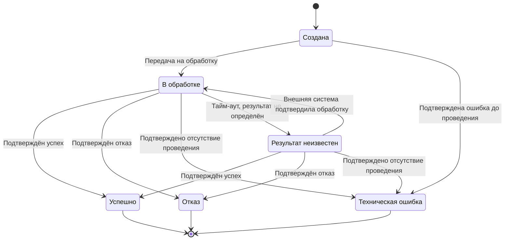

# Бизнес-правила

## 1. Назначение документа

Документ определяет бизнес-правила сервиса приёма платежей по QR-коду, ограничения на выполнение операций и правила изменения состояний платёжного запроса и платёжной операции.

## 2. Основные правила

| ID | Правило | Обоснование |
|---|---|---|
| BR-001 | Создавать платёжные запросы разрешено только зарегистрированным торговым точкам, имеющим право принимать платежи. | Контроль доступа к приёму платежей |
| BR-002 | Каждый платёжный запрос должен иметь уникальный идентификатор в пределах системы. | Однозначная идентификация запроса |
| BR-003 | Платёжный запрос должен содержать сумму и валюту платежа. Сумма должна быть положительной и соответствовать установленным ограничениям. | Исключение некорректных платежей |
| BR-004 | После создания платёжного запроса сумма и валюта не изменяются. Если параметры покупки изменились, торговая точка должна создать новый платёжный запрос. | Согласованность сведений, показанных клиенту, с фактическим платежом |
| BR-005 | Динамический QR-код должен однозначно ссылаться на конкретный платёжный запрос. | Связь QR-кода с покупкой |
| BR-006 | QR-код должен содержать только сведения, необходимые для идентификации или получения платёжного запроса. Актуальные параметры платежа должны проверяться сервисом. | Защита от подмены суммы и реквизитов |
| BR-007 | Платёжный запрос имеет определённый срок действия. После его истечения начать новую оплату по этому запросу нельзя. | Ограничение периода доступности оплаты |
| BR-008 | До подтверждения платежа клиенту должны быть показаны как минимум получатель, сумма и валюта. | Осознанное подтверждение операции |
| BR-009 | До инициирования платежа сервис должен проверить, что платёжный запрос доступен для оплаты, не истёк и не имеет уже выполняющейся операции. | Защита от повторного проведения |
| BR-010 | Платёжный запрос и платёжная операция являются разными сущностями и имеют разные идентификаторы. | Разделение покупки и попытки её оплаты |
| BR-011 | По одному платёжному запросу допускается не более одной одновременно выполняющейся платёжной операции. | Исключение параллельных попыток оплаты |
| BR-012 | По одному платёжному запросу допускается не более одной успешной платёжной операции. | Предотвращение двойной оплаты |
| BR-013 | Новая попытка оплаты допускается только после получения окончательного результата предыдущей попытки, если платёжный запрос остаётся активным и другие ограничения соблюдены. | Управляемая повторная попытка после отказа |
| BR-014 | Повтор команды с тем же ключом идемпотентности не должен создавать новую бизнес-операцию. При повторном запросе с тем же ключом, но другим содержимым сервис должен возвращать конфликт. | Предотвращение дублирования |
| BR-015 | Тайм-аут ожидания ответа внешней системы сам по себе не является отказом в проведении платежа. | Предотвращение повторного списания при неизвестном результате |
| BR-016 | Итоговый статус успешной операции устанавливается только на основании подтверждённого результата от платёжной инфраструктуры. | Достоверность статуса платежа |
| BR-017 | Запоздавшее или повторное уведомление не должно изменять уже зафиксированный итоговый статус операции на противоречивый статус без процедуры разрешения расхождения. | Сохранение целостности состояния |
| BR-018 | Ошибка доставки уведомления торговой точке не меняет статус платёжной операции. | Независимость платёжного результата от доставки сообщения |
| BR-019 | Доступ к сведениям о платёжном запросе и операции предоставляется только участникам с соответствующими полномочиями. | Защита данных |
| BR-020 | Каждое значимое изменение статуса должно фиксироваться в истории с указанием времени изменения. | Аудит жизненного цикла платежа |

## 3. Состояния платёжного запроса

Состояние платёжного запроса отражает возможность использовать его для оплаты покупки.

| Статус | Описание | Допустимые дальнейшие переходы |
|---|---|---|
| ACTIVE | Запрос создан, срок действия не истёк, успешная оплата отсутствует | PAID, EXPIRED |
| PAID | По запросу подтверждена успешная оплата | Нет |
| EXPIRED | Срок действия запроса истёк до успешной оплаты | Нет |

### Правила переходов

1. При успешном создании платёжный запрос получает статус `ACTIVE`.
2. При истечении срока действия запрос переходит в `EXPIRED`, если он ещё не оплачен.
3. После подтверждённой успешной оплаты запрос переходит в `PAID`.
4. Запрос в статусе `PAID` или `EXPIRED` нельзя использовать для новой оплаты.
5. Если попытка оплаты завершилась окончательным отказом, запрос может оставаться в статусе `ACTIVE`, пока срок его действия не истёк и повторная попытка не запрещена другими правилами.

## 4. Состояния платёжной операции

| Статус | Описание | Итоговый статус |
|---|---|---|
| CREATED | Операция создана, но ещё не передана на обработку | Нет |
| PROCESSING | Операция передана во внешнюю систему, итоговый результат ещё не получен | Нет |
| UNKNOWN | Результат пока невозможно достоверно определить | Нет |
| SUCCEEDED | Успешное проведение подтверждено | Да |
| DECLINED | Получен окончательный отказ в проведении платежа | Да |
| FAILED | Подтверждено, что операция не была проведена из-за технической ошибки | Да |

### Правила переходов

1. Новая платёжная операция создаётся в статусе `CREATED`.
2. После передачи на обработку операция переходит в `PROCESSING`.
3. При подтверждённом успешном результате операция переходит в `SUCCEEDED`.
4. При окончательном отказе платёжной инфраструктуры операция переходит в `DECLINED`.
5. Статус `FAILED` применяется только тогда, когда достоверно установлено, что операция не была проведена.
6. Если ответ не получен и итог неизвестен, операция переводится в `UNKNOWN`.
7. Операция в статусе `UNKNOWN` должна быть уточнена запросом актуального состояния или другим согласованным механизмом. Повторно инициировать тот же платёж только из-за тайм-аута запрещено.
8. Из статусов `SUCCEEDED`, `DECLINED` и `FAILED` операция не возвращается в промежуточные состояния.
9. После окончательного отказа или подтверждённой технической неудачи новая попытка может создать новую платёжную операцию, если платёжный запрос всё ещё активен.

## 5. Диаграмма состояний платёжной операции

Исходный код диаграммы: [payment-state.mmd](../diagrams/mermaid/payment-state.mmd).

## 6. Правила обработки уведомлений

1. Уведомление торговой точке формируется на основании сохранённого состояния операции.
2. Каждому событию об изменении состояния назначается уникальный идентификатор.
3. Повторная отправка использует идентификатор исходного события, чтобы получатель мог распознать дубликат.
4. Ошибка доставки регистрируется отдельно от результата платежа.
5. При необходимости торговая точка должна иметь возможность запросить актуальный статус через предусмотренный интерфейс.

## 7. Открытые вопросы

1. Каков срок действия платёжного запроса по умолчанию?
2. Какие конкретные ограничения по сумме применяются?
3. При каких отказах допускается повторная попытка по тому же запросу?
4. Какой механизм подтверждения итогового результата предоставляет платёжная инфраструктура?
5. Как сервис должен поступать при противоречащих друг другу сообщениях о результате?
6. Допускается ли принудительное блокирование платёжного запроса и кто имеет на это право?