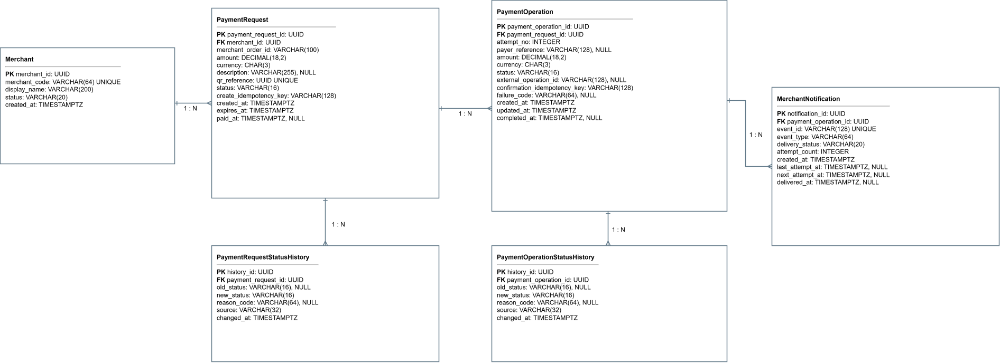

# Модель данных

## 1. Назначение документа

Документ описывает логическую модель данных сервиса приёма платежей по QR-коду.

Модель фиксирует основные сущности, их атрибуты, связи и ограничения, необходимые для реализации сценария создания платёжного запроса, оплаты по QR-коду, хранения истории статусов и передачи результата торговой точке.

## 2. Принципы моделирования

1. Платёжный запрос и платёжная операция являются разными сущностями.
2. Один платёжный запрос соответствует одной покупке.
3. По одному платёжному запросу может существовать несколько платёжных операций, но только одна одновременно выполняющаяся.
4. История изменений статусов хранится отдельно от текущего состояния сущности.
5. Уведомления торговой точке хранятся отдельно, чтобы можно было отслеживать доставку и повторные попытки.
6. Денежные значения не должны храниться в формате с плавающей точкой.
7. Все временные отметки хранятся в UTC.

## 3. Состав сущностей

| Сущность | Назначение |
|---|---|
| `Merchant` | Торговая точка, создающая платёжные запросы и получающая результат оплаты |
| `PaymentRequest` | Платёжный запрос, связанный с конкретной покупкой и QR-кодом |
| `PaymentOperation` | Конкретная попытка проведения платежа по платёжному запросу |
| `PaymentRequestStatusHistory` | История изменений статуса платёжного запроса |
| `PaymentOperationStatusHistory` | История изменений статуса платёжной операции |
| `MerchantNotification` | Уведомление, передаваемое торговой точке о результате операции |

## 4. Связи между сущностями

| От | К | Тип связи | Описание |
|---|---|---|---|
| `Merchant` | `PaymentRequest` | 1:N | Одна торговая точка может создавать много платёжных запросов |
| `PaymentRequest` | `PaymentOperation` | 1:N | По одному запросу могут возникать несколько операций в рамках допустимой бизнес-логики |
| `PaymentRequest` | `PaymentRequestStatusHistory` | 1:N | У запроса может быть много записей истории статусов |
| `PaymentOperation` | `PaymentOperationStatusHistory` | 1:N | У операции может быть много записей истории статусов |
| `PaymentOperation` | `MerchantNotification` | 1:N | По одной операции может быть несколько уведомлений из-за повторной доставки |
| `Merchant` | `MerchantNotification` | 1:N | Торговая точка получает много уведомлений по разным операциям |

## 5. Описание сущностей

### 5.1. Merchant

Сущность хранит сведения о торговой точке, участвующей в создании платёжных запросов и получении результатов оплаты.

| Поле | Тип | Обязательность | Описание |
|---|---|---|---|
| `merchant_id` | UUID | Да | Уникальный идентификатор торговой точки |
| `merchant_name` | String | Да | Наименование торговой точки |
| `merchant_status` | Enum | Да | Статус подключения торговой точки |
| `created_at` | Timestamp | Да | Дата и время создания записи |
| `updated_at` | Timestamp | Да | Дата и время последнего изменения |

### Допустимые значения `merchant_status`

| Значение | Описание |
|---|---|
| `ACTIVE` | Торговая точка может создавать платёжные запросы |
| `SUSPENDED` | Торговая точка временно ограничена |
| `BLOCKED` | Торговая точка не может работать с сервисом |

### Ключевые ограничения

- `merchant_id` уникален.
- Только торговая точка со статусом `ACTIVE` может создавать платёжные запросы.

---

### 5.2. PaymentRequest

Сущность описывает платёжный запрос, связанный с конкретной покупкой и QR-кодом.

| Поле | Тип | Обязательность | Описание |
|---|---|---|---|
| `payment_request_id` | UUID | Да | Уникальный идентификатор платёжного запроса |
| `merchant_id` | UUID | Да | Ссылка на торговую точку |
| `order_id` | String | Да | Идентификатор заказа в системе торговой точки |
| `amount` | Decimal | Да | Сумма покупки |
| `currency` | String | Да | Валюта платежа |
| `description` | String | Нет | Назначение платежа или описание покупки |
| `qr_reference` | String | Да | Технический идентификатор или ссылка для формирования QR |
| `status` | Enum | Да | Текущий статус платёжного запроса |
| `expires_at` | Timestamp | Да | Дата и время окончания срока действия запроса |
| `created_at` | Timestamp | Да | Дата и время создания |
| `updated_at` | Timestamp | Да | Дата и время последнего изменения |
| `idempotency_key` | String | Да | Ключ идемпотентности при создании запроса |

### Допустимые значения `status`

| Значение | Описание |
|---|---|
| `ACTIVE` | Платёжный запрос доступен для оплаты |
| `PAID` | По запросу подтверждена успешная оплата |
| `EXPIRED` | Срок действия запроса истёк |
| `CANCELED` | Запрос отменён до завершения оплаты |

### Ключевые ограничения

- `payment_request_id` уникален.
- `qr_reference` уникален.
- `idempotency_key` уникален в пределах торговой точки или другого согласованного контекста.
- `amount > 0`.
- `expires_at > created_at`.
- После создания сумма и валюта не изменяются.
- В статусе `PAID` или `EXPIRED` новый успешный платёж по этому запросу невозможен.

---

### 5.3. PaymentOperation

Сущность описывает конкретную попытку проведения платежа по платёжному запросу.

| Поле | Тип | Обязательность | Описание |
|---|---|---|---|
| `payment_operation_id` | UUID | Да | Уникальный идентификатор операции |
| `payment_request_id` | UUID | Да | Ссылка на платёжный запрос |
| `operation_number` | Integer | Да | Порядковый номер попытки по запросу |
| `status` | Enum | Да | Текущий статус операции |
| `provider_reference` | String | Нет | Идентификатор операции во внешней платёжной инфраструктуре |
| `idempotency_key` | String | Да | Ключ идемпотентности команды подтверждения |
| `failure_reason_code` | String | Нет | Код причины отказа или ошибки |
| `failure_reason_text` | String | Нет | Текстовое описание причины |
| `created_at` | Timestamp | Да | Дата и время создания операции |
| `updated_at` | Timestamp | Да | Дата и время последнего изменения |
| `confirmed_at` | Timestamp | Нет | Дата и время подтверждения оплаты |
| `finalized_at` | Timestamp | Нет | Дата и время фиксации итогового статуса |

### Допустимые значения `status`

| Значение | Описание |
|---|---|
| `CREATED` | Операция создана, но ещё не передана на обработку |
| `PROCESSING` | Операция передана во внешнюю систему |
| `UNKNOWN` | Итоговый результат временно не определён |
| `SUCCEEDED` | Платёж успешно проведён |
| `DECLINED` | Получен окончательный отказ |
| `FAILED` | Подтверждена техническая неудача проведения |

### Ключевые ограничения

- `payment_operation_id` уникален.
- `payment_request_id` обязателен.
- `operation_number` уникален в пределах одного `payment_request_id`.
- Одновременно может существовать не более одной активной операции по одному запросу.
- `idempotency_key` уникален в пределах определённого сценария подтверждения.
- У операции может быть не более одного итогового статуса.

---

### 5.4. PaymentRequestStatusHistory

Сущность хранит историю изменений статуса платёжного запроса.

| Поле | Тип | Обязательность | Описание |
|---|---|---|---|
| `payment_request_status_history_id` | UUID | Да | Уникальный идентификатор записи истории |
| `payment_request_id` | UUID | Да | Ссылка на платёжный запрос |
| `status` | Enum | Да | Статус на момент записи |
| `changed_at` | Timestamp | Да | Дата и время изменения статуса |
| `reason_code` | String | Нет | Код причины изменения |
| `reason_text` | String | Нет | Текстовое пояснение |

### Ключевые ограничения

- История создаётся при каждом значимом изменении статуса.
- Запись истории не изменяется после сохранения.

---

### 5.5. PaymentOperationStatusHistory

Сущность хранит историю изменений статуса платёжной операции.

| Поле | Тип | Обязательность | Описание |
|---|---|---|---|
| `payment_operation_status_history_id` | UUID | Да | Уникальный идентификатор записи истории |
| `payment_operation_id` | UUID | Да | Ссылка на платёжную операцию |
| `status` | Enum | Да | Статус на момент записи |
| `changed_at` | Timestamp | Да | Дата и время изменения статуса |
| `reason_code` | String | Нет | Код причины изменения |
| `reason_text` | String | Нет | Текстовое пояснение |

### Ключевые ограничения

- Для каждой значимой смены статуса создаётся отдельная запись.
- История операции используется для аудита и восстановления последовательности событий.

---

### 5.6. MerchantNotification

Сущность описывает уведомления, отправляемые торговой точке о результате платежа.

| Поле | Тип | Обязательность | Описание |
|---|---|---|---|
| `merchant_notification_id` | UUID | Да | Уникальный идентификатор уведомления |
| `merchant_id` | UUID | Да | Ссылка на торговую точку |
| `payment_operation_id` | UUID | Да | Ссылка на платёжную операцию |
| `event_id` | UUID | Да | Идентификатор события доставки |
| `status` | Enum | Да | Статус доставки уведомления |
| `delivery_attempt` | Integer | Да | Номер попытки доставки |
| `sent_at` | Timestamp | Да | Время отправки |
| `delivered_at` | Timestamp | Нет | Время успешной доставки |
| `failure_reason_code` | String | Нет | Код ошибки доставки |
| `failure_reason_text` | String | Нет | Текст ошибки доставки |

### Допустимые значения `status`

| Значение | Описание |
|---|---|
| `PENDING` | Уведомление ожидает доставки |
| `DELIVERED` | Уведомление успешно доставлено |
| `FAILED` | Доставка завершилась ошибкой |
| `RETRYING` | Выполняется повторная попытка |

### Ключевые ограничения

- Уведомления могут повторно отправляться.
- Повторная доставка не должна изменять статус самой платёжной операции.
- `event_id` используется для распознавания дубликатов у получателя.

## 6. Индексы и уникальности

| Сущность | Уникальность / индекс |
|---|---|
| `Merchant` | `merchant_id` уникален |
| `PaymentRequest` | `payment_request_id` уникален; `qr_reference` уникален; `merchant_id + order_id` может быть уникальным, если требуется защита от дублей |
| `PaymentOperation` | `payment_operation_id` уникален; `payment_request_id + operation_number` уникален |
| `PaymentRequestStatusHistory` | индекс по `payment_request_id`, `changed_at` |
| `PaymentOperationStatusHistory` | индекс по `payment_operation_id`, `changed_at` |
| `MerchantNotification` | индекс по `merchant_id`, `payment_operation_id`, `event_id` |

## 7. Допустимые проверки целостности

1. Нельзя создать платёжную операцию без существующего платёжного запроса.
2. Нельзя перевести платёжный запрос в `PAID`, если операция не получила подтверждённый успешный статус.
3. Нельзя создать вторую успешную операцию по одному платёжному запросу.
4. Нельзя сохранить историю статуса без ссылки на основную сущность.
5. Нельзя создать уведомление о доставке без связанной операции и торговой точки.

## 8. Связь с бизнес-правилами

Модель данных поддерживает следующие правила:

- разделение платёжного запроса и платёжной операции;
- хранение истории состояний;
- предотвращение повторной успешной оплаты;
- отслеживание уведомлений торговой точке;
- сохранение неопределённого результата до его уточнения.

## 9. Схема ERD

### Исходник диаграммы

`diagrams/drawio/erd-payment-model.drawio`

### SVG для просмотра

`diagrams/assets/erd-payment-model.svg`

### Вставка в документ

```markdown
## Диаграмма ERD

Исходник: [erd-payment-model.drawio](../diagrams/drawio/erd-payment-model.drawio).


```

## 10. Открытые вопросы

1. Нужна ли отдельная сущность для хранения QR-артефакта, если `qr_reference` достаточно для MVP?
2. Требуется ли хранить сведения о клиенте в модели данных сервиса?
3. Какой объём истории статусов необходимо хранить для аудита?
4. Какие именно поля считаются обязательными для интеграции с внешней платёжной инфраструктурой?
5. Требуется ли отдельная сущность для маршрутизации уведомлений торговой точке?