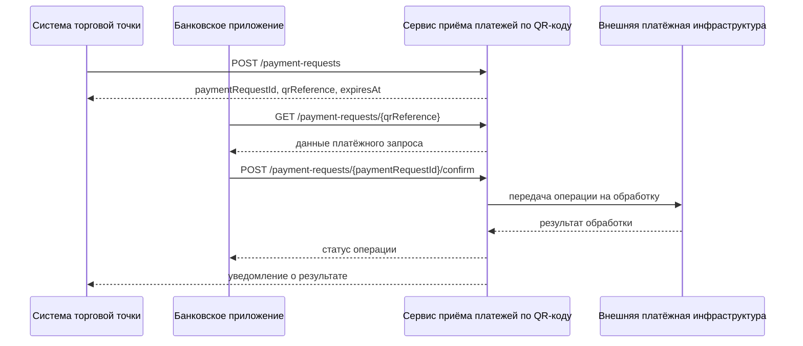

# API

## 1. Назначение документа

Документ описывает внешние и внутренние интерфейсы сервиса приёма платежей по QR-коду.

Спецификация охватывает:
- создание платёжного запроса;
- получение данных платёжного запроса по QR;
- подтверждение оплаты;
- получение статуса платежной операции;
- передачу результата торговой точке;
- обработку результата, полученного от внешней платёжной инфраструктуры.

## 2. Общие принципы проектирования API

1. Все HTTP-методы и ресурсы описываются в версии `v1`.
2. API использует JSON как основной формат обмена данными.
3. Идентификаторы сущностей передаются как UUID.
4. Все денежные значения передаются без потери точности.
5. Все временные значения передаются в формате ISO 8601 с указанием часового пояса.
6. Повторные запросы, способные создать бизнес-операцию, должны поддерживать идемпотентность.
7. При ошибках API возвращает структурированный ответ с кодом ошибки и текстовым описанием.
8. Нельзя полагаться на повторную отправку того же запроса как на способ создания новой операции без явного изменения бизнес-смысла.

## 3. Участники интеграции

| Участник | Роль |
|---|---|
| Система торговой точки | Создаёт платёжный запрос и получает результат оплаты |
| Банковское приложение клиента | Получает данные QR и подтверждает оплату |
| Сервис приёма платежей по QR-коду | Обрабатывает платёжные запросы и операции |
| Внешняя платёжная инфраструктура | Проводит денежную операцию |
| Сервис уведомлений / webhook | Доставляет результат торговой точке, если доставка вынесена в отдельный механизм |

## 4. Форматы общих заголовков

### 4.1. Обязательные заголовки

| Заголовок | Обязательность | Назначение |
|---|---|---|
| `Authorization` | Да для защищённых запросов | Передача токена доступа |
| `Content-Type` | Да | Формат тела запроса |
| `Accept` | Да | Ожидаемый формат ответа |
| `X-Request-Id` | Рекомендуется | Корреляция запроса |
| `Idempotency-Key` | Да для операций создания и подтверждения | Защита от дублирования |

### 4.2. Общие правила

- `X-Request-Id` используется для трассировки.
- `Idempotency-Key` должен быть уникален в пределах сценария и участника, для которого он используется.
- При повторной передаче того же ключа и тех же данных сервис возвращает ранее созданный результат либо текущее состояние операции.
- Если тот же `Idempotency-Key` передан с другими данными, сервис возвращает конфликт.

## 5. Модель общих ошибок

### 5.1. Формат ошибки

```json
{
  "error": {
    "code": "INVALID_REQUEST",
    "message": "Некорректные параметры запроса",
    "details": [
      {
        "field": "amount",
        "issue": "Сумма должна быть больше нуля"
      }
    ],
    "requestId": "2b7e2d74-2bd6-45d8-9a2f-8d3ec8b9e0a1",
    "timestamp": "2026-10-12T13:00:00Z"
  }
}
```

### 5.2. Общие коды ошибок

| HTTP | code | Назначение |
|---|---|---|
| 400 | `INVALID_REQUEST` | Ошибка валидации входных данных |
| 401 | `UNAUTHORIZED` | Отсутствует или недействителен токен |
| 403 | `FORBIDDEN` | Недостаточно прав |
| 404 | `NOT_FOUND` | Сущность не найдена |
| 409 | `CONFLICT` | Конфликт состояния или идемпотентности |
| 422 | `UNPROCESSABLE_ENTITY` | Запрос корректен по форме, но не может быть выполнен по бизнес-правилам |
| 429 | `TOO_MANY_REQUESTS` | Превышен лимит обращений |
| 500 | `INTERNAL_ERROR` | Внутренняя ошибка сервиса |
| 503 | `SERVICE_UNAVAILABLE` | Внешняя система или сам сервис временно недоступны |

## 6. Создание платёжного запроса

### 6.1. Назначение

Метод создаёт платёжный запрос для конкретной покупки и возвращает данные для формирования QR-кода.

### 6.2. Endpoint

`POST /api/v1/payment-requests`

### 6.3. Права доступа

- Доступно только зарегистрированной торговой точке.
- Инициатором является система торговой точки.

### 6.4. Заголовки

- `Authorization`
- `Content-Type: application/json`
- `Accept: application/json`
- `Idempotency-Key`
- `X-Request-Id` — рекомендуется

### 6.5. Тело запроса

```json
{
  "merchantId": "8e3b1e4c-9f30-4d1f-a7f9-41cb8a1b2d10",
  "orderId": "ORDER-2026-0001",
  "amount": "1250.00",
  "currency": "RUB",
  "description": "Оплата заказа №2026-0001",
  "expiresAt": "2026-10-12T15:00:00Z"
}
```

### 6.6. Поля запроса

| Поле | Тип | Обязательность | Описание |
|---|---|---|---|
| `merchantId` | UUID | Да | Идентификатор торговой точки |
| `orderId` | String | Да | Идентификатор заказа в системе торговой точки |
| `amount` | Decimal | Да | Сумма покупки |
| `currency` | String | Да | Валюта платежа |
| `description` | String | Нет | Назначение платежа |
| `expiresAt` | Timestamp | Нет | Время истечения платёжного запроса |

### 6.7. Проверки

Сервис должен проверить:
- наличие обязательных полей;
- корректность формата данных;
- право торговой точки создавать платёжный запрос;
- допустимость суммы;
- уникальность запроса в контексте идемпотентности;
- корректность срока действия.

### 6.8. Ответ при успехе

HTTP `201 Created`

```json
{
  "paymentRequestId": "9b10d56f-58f1-48e5-92a6-b6e69b02f9c1",
  "merchantId": "8e3b1e4c-9f30-4d1f-a7f9-41cb8a1b2d10",
  "orderId": "ORDER-2026-0001",
  "amount": "1250.00",
  "currency": "RUB",
  "description": "Оплата заказа №2026-0001",
  "qrReference": "qrpay://request/9b10d56f-58f1-48e5-92a6-b6e69b02f9c1",
  "status": "ACTIVE",
  "expiresAt": "2026-10-12T15:00:00Z",
  "createdAt": "2026-10-12T13:00:00Z"
}
```

### 6.9. Возможные ошибки

| HTTP | code | Ситуация |
|---|---|---|
| 400 | `INVALID_REQUEST` | Ошибка валидации |
| 401 | `UNAUTHORIZED` | Нет авторизации |
| 403 | `FORBIDDEN` | Торговая точка не может создавать запрос |
| 409 | `CONFLICT` | Повтор с тем же ключом идемпотентности и другими данными |
| 422 | `UNPROCESSABLE_ENTITY` | Сумма или срок действия нарушают бизнес-правила |
| 500 | `INTERNAL_ERROR` | Внутренняя ошибка |

## 7. Получение данных платёжного запроса по QR

### 7.1. Назначение

Метод используется банковским приложением клиента для получения актуальных данных платёжного запроса после сканирования QR-кода.

### 7.2. Endpoint

`GET /api/v1/payment-requests/{qrReference}`

### 7.3. Права доступа

- Доступно авторизованному клиенту через банковское приложение.
- Допускается проверка прав на уровень канала или токена.

### 7.4. Параметры пути

| Поле | Тип | Описание |
|---|---|---|
| `qrReference` | String | Идентификатор, извлечённый из QR-кода |

### 7.5. Ответ при успехе

HTTP `200 OK`

```json
{
  "paymentRequestId": "9b10d56f-58f1-48e5-92a6-b6e69b02f9c1",
  "merchantName": "ООО Пример",
  "amount": "1250.00",
  "currency": "RUB",
  "description": "Оплата заказа №2026-0001",
  "status": "ACTIVE",
  "expiresAt": "2026-10-12T15:00:00Z"
}
```

### 7.6. Проверки

Сервис должен проверить:
- существование запроса;
- актуальность срока действия;
- доступность запроса для оплаты;
- соответствие бизнес-правилам.

### 7.7. Возможные ошибки

| HTTP | code | Ситуация |
|---|---|---|
| 400 | `INVALID_REQUEST` | Некорректный QR-параметр |
| 401 | `UNAUTHORIZED` | Нет авторизации |
| 404 | `NOT_FOUND` | Запрос не найден |
| 410 | `GONE` | QR устарел или запрос недоступен для оплаты |
| 422 | `UNPROCESSABLE_ENTITY` | Запрос нельзя использовать для оплаты по бизнес-правилам |
| 500 | `INTERNAL_ERROR` | Внутренняя ошибка |

## 8. Подтверждение оплаты

### 8.1. Назначение

Метод создаёт платёжную операцию и передаёт её во внешнюю платёжную инфраструктуру после подтверждения клиентом.

### 8.2. Endpoint

`POST /api/v1/payment-requests/{paymentRequestId}/confirm`

### 8.3. Права доступа

- Доступно авторизованному клиенту через банковское приложение.
- Выполняется после проверки данных платёжного запроса на стороне клиента.

### 8.4. Заголовки

- `Authorization`
- `Content-Type: application/json`
- `Accept: application/json`
- `Idempotency-Key`
- `X-Request-Id` — рекомендуется

### 8.5. Тело запроса

```json
{
  "clientConfirmation": true,
  "sourceAccountId": "e540c0f2-2bd5-4b1a-9a05-2ee0b41b8f99"
}
```

### 8.6. Поля запроса

| Поле | Тип | Обязательность | Описание |
|---|---|---|---|
| `clientConfirmation` | Boolean | Да | Подтверждение оплаты клиентом |
| `sourceAccountId` | UUID | Нет | Счёт списания, если требуется выбор конкретного счёта |

### 8.7. Проверки

Перед созданием операции сервис должен проверить:
- что платёжный запрос существует;
- что срок действия не истёк;
- что запрос не оплачен;
- что по запросу нет уже выполняющейся операции;
- что клиент имеет право выполнять оплату;
- что идемпотентность соблюдена.

### 8.8. Ответ при синхронном успехе

HTTP `200 OK` или `202 Accepted` в зависимости от схемы обработки результата.

Если результат уже известен:

```json
{
  "paymentOperationId": "f15e4b27-6c3e-4a08-8c55-3cbe0d9cc561",
  "paymentRequestId": "9b10d56f-58f1-48e5-92a6-b6e69b02f9c1",
  "status": "SUCCEEDED",
  "providerReference": "prov-1048576",
  "confirmedAt": "2026-10-12T13:01:15Z",
  "finalizedAt": "2026-10-12T13:01:18Z"
}
```

Если обработка продолжается:

```json
{
  "paymentOperationId": "f15e4b27-6c3e-4a08-8c55-3cbe0d9cc561",
  "paymentRequestId": "9b10d56f-58f1-48e5-92a6-b6e69b02f9c1",
  "status": "PROCESSING",
  "providerReference": "prov-1048576",
  "confirmedAt": "2026-10-12T13:01:15Z"
}
```

### 8.9. Возможные ошибки

| HTTP | code | Ситуация |
|---|---|---|
| 400 | `INVALID_REQUEST` | Ошибка формата |
| 401 | `UNAUTHORIZED` | Нет авторизации |
| 403 | `FORBIDDEN` | Клиент не может выполнить операцию |
| 404 | `NOT_FOUND` | Платёжный запрос не найден |
| 409 | `CONFLICT` | Уже есть активная операция или повтор с другим содержимым |
| 410 | `GONE` | Запрос истёк или больше недоступен |
| 422 | `UNPROCESSABLE_ENTITY` | Нарушены бизнес-правила |
| 503 | `SERVICE_UNAVAILABLE` | Внешняя платёжная инфраструктура недоступна |
| 500 | `INTERNAL_ERROR` | Внутренняя ошибка |

## 9. Получение статуса платёжной операции

### 9.1. Назначение

Метод позволяет получить текущий статус операции по её идентификатору.

### 9.2. Endpoint

`GET /api/v1/payment-operations/{paymentOperationId}`

### 9.3. Права доступа

- Авторизованный клиент может получить статус своих операций.
- Торговая точка может получить статус операций, связанных со своими запросами.
- Служебные роли могут иметь расширенный доступ по отдельному соглашению.

### 9.4. Ответ при успехе

HTTP `200 OK`

```json
{
  "paymentOperationId": "f15e4b27-6c3e-4a08-8c55-3cbe0d9cc561",
  "paymentRequestId": "9b10d56f-58f1-48e5-92a6-b6e69b02f9c1",
  "status": "SUCCEEDED",
  "providerReference": "prov-1048576",
  "updatedAt": "2026-10-12T13:01:18Z",
  "failureReasonCode": null,
  "failureReasonText": null
}
```

### 9.5. Возможные ошибки

| HTTP | code | Ситуация |
|---|---|---|
| 401 | `UNAUTHORIZED` | Нет авторизации |
| 403 | `FORBIDDEN` | Недостаточно прав |
| 404 | `NOT_FOUND` | Операция не найдена |
| 500 | `INTERNAL_ERROR` | Внутренняя ошибка |

## 10. Передача результата торговой точке

### 10.1. Назначение

Сервис отправляет торговой точке уведомление об изменении статуса платежа.

### 10.2. Endpoint получателя

`POST /api/v1/merchant-notifications/payment-result`

Это endpoint получателя, если доставка реализована через webhook.

### 10.3. Тело уведомления

```json
{
  "eventId": "f1d8e7d2-8f2d-4c21-8d41-df3e8f1c75e5",
  "merchantId": "8e3b1e4c-9f30-4d1f-a7f9-41cb8a1b2d10",
  "paymentRequestId": "9b10d56f-58f1-48e5-92a6-b6e69b02f9c1",
  "paymentOperationId": "f15e4b27-6c3e-4a08-8c55-3cbe0d9cc561",
  "status": "SUCCEEDED",
  "deliveredAt": "2026-10-12T13:01:20Z"
}
```

### 10.4. Поведение получателя

Получатель должен:
- подтвердить получение уведомления;
- обрабатывать повторную доставку как дубликат, если `eventId` уже был обработан;
- не повторять бизнес-операции на основании повторного уведомления.

### 10.5. Ответ получателя при успехе

HTTP `200 OK` или `204 No Content`

### 10.6. Возможные ошибки доставки

| Ситуация | Поведение |
|---|---|
| Получатель временно недоступен | Повторить доставку по политике повторов |
| Получен неуспешный HTTP-код | Зафиксировать ошибку доставки |
| Истёк лимит повторов | Перевести уведомление в окончательно не доставленное состояние |

## 11. Получение результата от внешней платёжной инфраструктуры

### 11.1. Назначение

Метод описывает входящее подтверждение или уведомление от внешней платёжной инфраструктуры о результате операции.

### 11.2. Endpoint

`POST /api/v1/payment-provider/callbacks/payment-result`

### 11.3. Тело запроса

```json
{
  "providerReference": "prov-1048576",
  "paymentOperationId": "f15e4b27-6c3e-4a08-8c55-3cbe0d9cc561",
  "status": "SUCCEEDED",
  "reasonCode": null,
  "reasonText": null,
  "eventTime": "2026-10-12T13:01:18Z"
}
```

### 11.4. Проверки

Сервис должен проверить:
- подлинность источника уведомления;
- соответствие `providerReference` и `paymentOperationId`;
- допустимость перехода статуса;
- отсутствие нарушения идемпотентности.

### 11.5. Ответ при успехе

HTTP `200 OK`

```json
{
  "result": "ACCEPTED"
}
```

### 11.6. Возможные ошибки

| HTTP | code | Ситуация |
|---|---|---|
| 400 | `INVALID_REQUEST` | Ошибка формата |
| 401 | `UNAUTHORIZED` | Источник не подтверждён |
| 404 | `NOT_FOUND` | Операция не найдена |
| 409 | `CONFLICT` | Несовместимый переход статуса |
| 500 | `INTERNAL_ERROR` | Внутренняя ошибка |

## 12. Сводная таблица статусов

### 12.1. Статусы платёжного запроса

| Статус | Значение |
|---|---|
| `ACTIVE` | Запрос доступен для оплаты |
| `PAID` | Запрос успешно оплачен |
| `EXPIRED` | Срок действия истёк |
| `CANCELED` | Запрос отменён |

### 12.2. Статусы платёжной операции

| Статус | Значение |
|---|---|
| `CREATED` | Операция создана |
| `PROCESSING` | Операция передана на обработку |
| `UNKNOWN` | Итог пока не определён |
| `SUCCEEDED` | Платёж успешен |
| `DECLINED` | Платёж отклонён |
| `FAILED` | Техническая неудача |

## 13. Правила идемпотентности

1. `POST /payment-requests` должен быть идемпотентным по созданию платёжного запроса.
2. `POST /payment-requests/{paymentRequestId}/confirm` должен быть идемпотентным по подтверждению операции.
3. Повторный запрос с тем же ключом и тем же телом должен возвращать прежний результат либо текущее состояние.
4. Повторный запрос с тем же ключом и другим телом должен возвращать конфликт.

## 14. Связь с моделью данных

| API-объект | Сущность модели данных |
|---|---|
| Создание платёжного запроса | `PaymentRequest` |
| Подтверждение оплаты | `PaymentOperation` |
| История статусов | `PaymentRequestStatusHistory`, `PaymentOperationStatusHistory` |
| Уведомление торговой точке | `MerchantNotification` |

## 15. Связь с диаграммой последовательности

Исходник диаграммы: [sequence-payment.mmd](../diagrams/mermaid/sequence-payment.mmd).

Диаграмма ниже должна совпадать с исходником в `diagrams/mermaid/sequence-payment.mmd`.



## 16. Открытые вопросы

1. Должен ли API возвращать один и тот же итог синхронно для части операций и асинхронно для остальных?
2. Какой точный контракт webhook должен использоваться для уведомления торговой точки?
3. Требуется ли отдельный endpoint для получения истории событий по операции?
4. Нужно ли разрешать торговой точке запрашивать статус по `orderId`, а не только по `paymentOperationId`?
5. Какие поля ответа доступны клиенту, а какие только торговой точке?
6. Как именно будет определяться окончательный статус `UNKNOWN`, если внешняя система не отвечает?